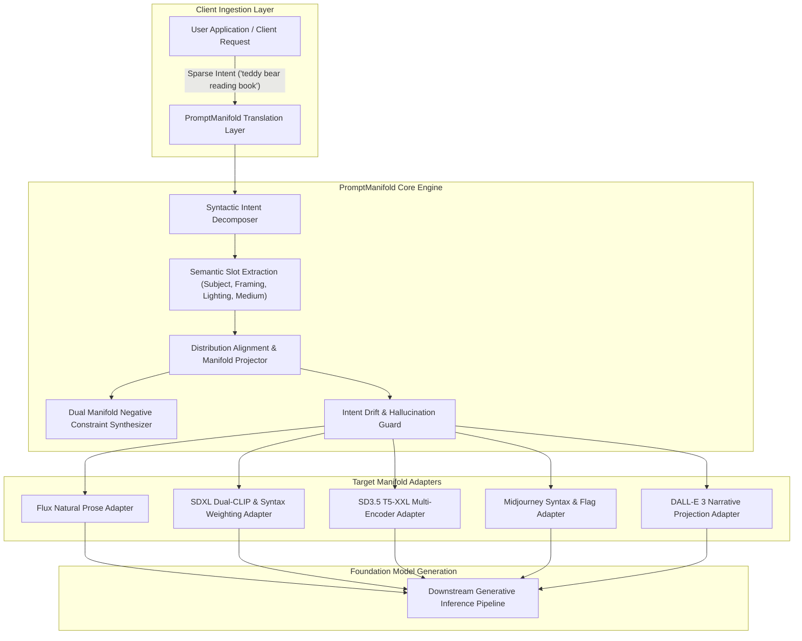

# PromptManifold

Inference-Time Prompt Distribution Alignment and Manifold Projection Engine for Generative Models.

## Overview

Modern text-to-image and multimodal generative models (such as Flux, Stable Diffusion 3.5, SDXL, Midjourney, and DALL-E 3) exhibit severe performance degradation when exposed to sparse, conversational user prompts. Foundation models are trained predominantly on dense, synthetic, and re-captioned text manifolds (~80 to 150 words containing explicit lighting schemas, focal parameters, spatial framing, atmospheric conditions, and stylistic constraints). When users supply sparse input (for example, "a teddy bear reading a book"), a profound train-inference distribution mismatch occurs. The model evaluates out-of-distribution prompts, collapsing latent diversity and producing generic visual outputs.

Traditional engineering attempts to remediate this by fine-tuning or retraining the underlying foundation weights on sparse prompts ("fixing the engine, not the fuel"). This approach incurs substantial compute expenditures, risks catastrophic forgetting of pre-trained visual knowledge, and degrades general reasoning.

PromptManifold implements an ultra-low-latency inference-time translation layer. By operating as an intermediary between user clients and generative backends, PromptManifold projects sparse user intent directly onto the model's training prompt manifold without altering foundation model weights.

## Core Architectural Pillars

- **Sparse Intent Decomposition**: Extracts foundational semantic anchors, spatial constraints, and artistic intent without semantic drift or entity hallucination.
- **In-Distribution Manifold Projection**: Maps extracted slots to target training manifolds using verified prompt topologies (composition, volumetric lighting, optical lens parameters, rendering engines).
- **Target Model Adapters**: Native syntax and token budget optimization for Flux, SDXL, Stable Diffusion 3/3.5, Midjourney v6+, and DALL-E 3.
- **Dual Manifold Negative Synthesis**: Automatically derives paired negative prompts to steer sampling vectors away from low-fidelity latent attractors.
- **Intent Drift Guard**: Real-time evaluation of semantic proximity to ensure enhanced prompts strictly adhere to user intent without hijacking the subject.
- **High-Throughput Streaming & Server**: Asynchronous batch pipeline and streaming API designed for high-QPS production environments with sub-millisecond heuristic pathways.
- **Anti-AI-Slop Telemetry Console**: Production-grade developer interface adhering to Linear and Datadog systems standards for live prompt inspection and distribution diagnostics.
