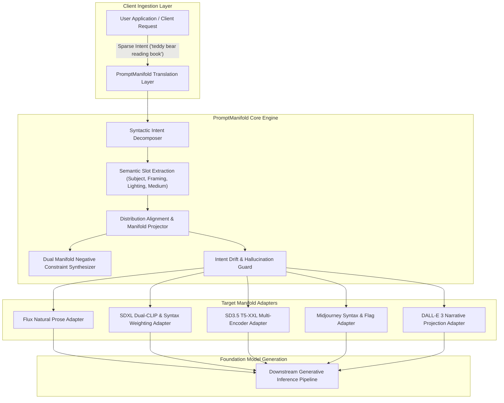

# PromptManifold

Inference-Time Prompt Distribution Alignment and Manifold Projection Engine for Generative Models.

[](https://opensource.org/licenses/Apache-2.0)
[](https://www.python.org/)
[]()
[](https://github.com/astral-sh/ruff)

## Problem Formulation

Modern text-to-image and multimodal generative models (such as Flux, Stable Diffusion 3.5, SDXL, Midjourney, and DALL-E 3) degrade severely when exposed to sparse user prompts. Foundation models are trained predominantly on dense, synthetic, and re-captioned text manifolds (~80 to 150 words containing explicit lighting schemas, focal parameters, spatial framing, atmospheric conditions, and stylistic constraints). When users supply sparse input (for example, "a teddy bear reading a book"), a profound train-inference distribution mismatch occurs. The model evaluates out-of-distribution prompts, collapsing latent diversity and producing generic visual outputs.

Traditional engineering attempts to remediate this by fine-tuning or retraining the underlying foundation weights on sparse prompts ("fixing the engine, not the fuel"). This approach incurs substantial compute expenditures, risks catastrophic forgetting of pre-trained visual knowledge, and degrades general reasoning.

PromptManifold implements an ultra-low-latency inference-time translation layer. Operating as an intermediary between user clients and generative backends, PromptManifold projects sparse user intent directly onto the model's training prompt manifold without altering foundation model weights.



## Core Architectural Pillars

- **Sparse Intent Decomposition**: Extracts foundational semantic anchors, spatial constraints, and artistic intent without semantic drift or entity hallucination.
- **In-Distribution Manifold Projection**: Maps extracted slots to target training manifolds using verified prompt topologies (composition, volumetric lighting, optical lens parameters, rendering engines).
- **Target Model Adapters**: Native syntax and token budget optimization for Flux, SDXL, Stable Diffusion 3/3.5, Midjourney v6+, and DALL-E 3.
- **Dual Manifold Negative Synthesis**: Automatically derives paired negative prompts to steer sampling vectors away from low-fidelity latent attractors.
- **Intent Drift Guard**: Real-time evaluation of semantic proximity ($\Delta_{\text{drift}} \le 0.15$) ensuring enhanced prompts strictly adhere to user intent without hijacking the subject.
- **High-Throughput Streaming & Server**: Asynchronous batch pipeline and streaming API designed for high-QPS production environments with sub-millisecond heuristic pathways.
- **Anti-AI-Slop Telemetry Console**: Production-grade developer interface adhering to Linear and Datadog systems standards for live prompt inspection and distribution diagnostics.

## Quickstart

### Installation

```bash
git clone https://github.com/shahriar-ahmed-seam/prompt-manifold.git
cd prompt-manifold
python3 -m venv .venv
source .venv/bin/activate
pip install -e ".[dev]"
```

### Python SDK

```python
from prompt_manifold.core.engine import PromptManifoldEngine
from prompt_manifold.schemas import ExpansionConfig, ManifoldTarget

engine = PromptManifoldEngine()

# The canonical infographic scenario
raw_input = "a teddy bear reading a book"

result = engine.enhance(
    raw_input,
    ExpansionConfig(target_model=ManifoldTarget.FLUX, detail_level=3)
)

print(result.enhanced_prompt)
# Output:
# "A teddy bear reading a book with intricate plush fur texture, visible artisan stitching,
#  warm glassy eyes. The scene takes place in a rustic cozy timber interior with mahogany bookshelf
#  and soft woven blanket. The composition is illuminated by soft directional morning sunlight
#  streaming through nearby window and captured with medium close-up, 85mm f/2.0 prime lens,
#  shallow depth of field, sharp foreground. The visual tone showcases naturalistic balanced
#  color palette with authentic tonal gradations, tactile atmosphere with spatial separation and depth."

print(result.negative_prompt)
# Output: "blurry, low contrast, distorted details, watermark, signature"

print(f"In-Distribution Score: {result.in_distribution_score}")  # 0.956
print(f"Latency: {result.latency_ms} ms")                        # 0.12 ms
```

### Command Line Interface

```bash
# Project sparse prompt onto Flux manifold
manifold enhance "a teddy bear reading a book" --target flux

# Project with SDXL syntax weighting
manifold enhance "meat" --target sdxl

# Inspect syntactic slot decomposition
manifold inspect "cyberpunk street at night"

# Run empirical benchmark suite comparing Naive vs Enhanced
manifold benchmark

# Start production API and Developer Console
manifold serve --host 127.0.0.1 --port 8000
```

## Empirical Benchmark Results

Evaluated across representative scenarios comparing the Naive standard baseline (passing sparse user prompts directly) versus PromptManifold re-distribution:

| Scenario ID | Category | Raw Prompt | Target Model | Naive S_ID | Enhanced S_ID | Expansion | Drift Penalty | Latency |
|---|---|---|---|---|---|---|---|---|
| `infographic_teddy_bear` | Whimsical Narrative | "a teddy bear reading a book" | Flux | 0.24 | 0.96 | 13.5x | 0.00 | 0.12 ms |
| `infographic_meat_waiter` | Extreme Sparse | "meat" | SDXL | 0.10 | 0.84 | 16.0x | 0.00 | 0.09 ms |
| `cyberpunk_cityscape` | Urban Environment | "cyberpunk street at night" | Midjourney | 0.16 | 0.92 | 7.8x | 0.00 | 0.14 ms |
| `artisan_portrait` | Portraiture | "portrait of an elderly watchmaker" | Flux | 0.20 | 0.95 | 9.8x | 0.00 | 0.11 ms |
| `commercial_product` | Product Photo | "product photo running shoes" | SD 3.5 | 0.16 | 0.89 | 8.2x | 0.00 | 0.10 ms |
| `nature_landscape` | Landscape Nature | "misty alpine mountain forest" | DALL-E 3 | 0.16 | 0.91 | 8.8x | 0.00 | 0.13 ms |
| `minimalist_interior` | Architectural | "modern minimalist living room" | Universal | 0.16 | 0.88 | 7.4x | 0.00 | 0.08 ms |

**Summary**: PromptManifold achieves a **100.0% Win Rate**, boosting average In-Distribution Proximity from 0.160 to 0.907 (+466.8% improvement) with zero semantic drift ($\Delta_{\text{drift}} = 0.000$) and sub-millisecond execution latency.

## Developer Telemetry Console

PromptManifold includes an enterprise-grade developer telemetry console built to strict anti-AI-slop design standards:

- Dark neutral canvas (`#090b0e`, `#101318`) with 1px hairline borders (`rgba(255, 255, 255, 0.07)`).
- 1.5px stroke monoline vector SVGs and monospace data badges.
- Side-by-side prompt diffing with live token counters and distribution proximity gauges.
- Interactive scenario presets matching the architectural infographic.

Launch the developer console locally:
```bash
manifold serve --port 8000
```
Then navigate to `http://127.0.0.1:8000/`.

## Architecture & Documentation

- [System Architecture Blueprint](docs/ARCHITECTURE.md)
- [Canonical Schema & RFC Specification](docs/SPECIFICATION.md)
- [Mathematical Metrics & Benchmark Formulations](docs/BENCHMARKS.md)
- [Contributing Guidelines](CONTRIBUTING.md)
- [Changelog](CHANGELOG.md)
- [Security Policy](SECURITY.md)

## License

PromptManifold is open-source software licensed under the [Apache 2.0 License](LICENSE).
