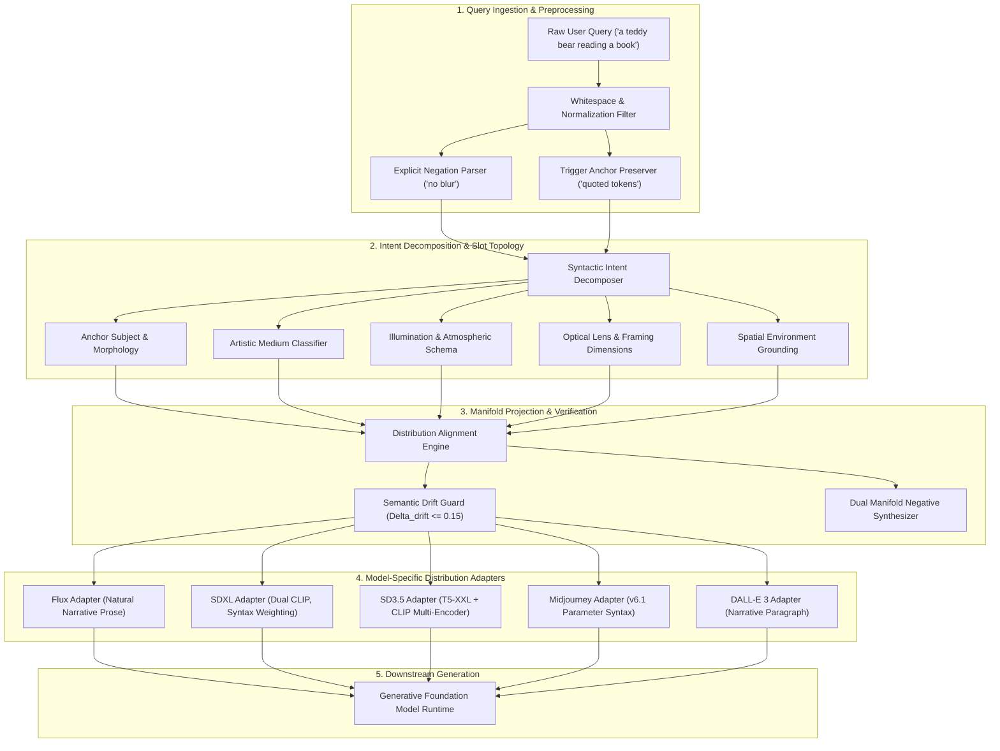
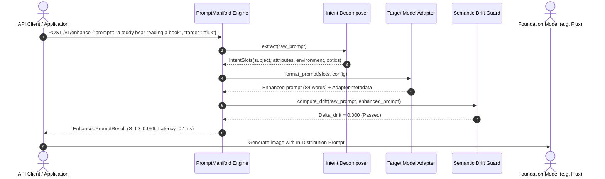
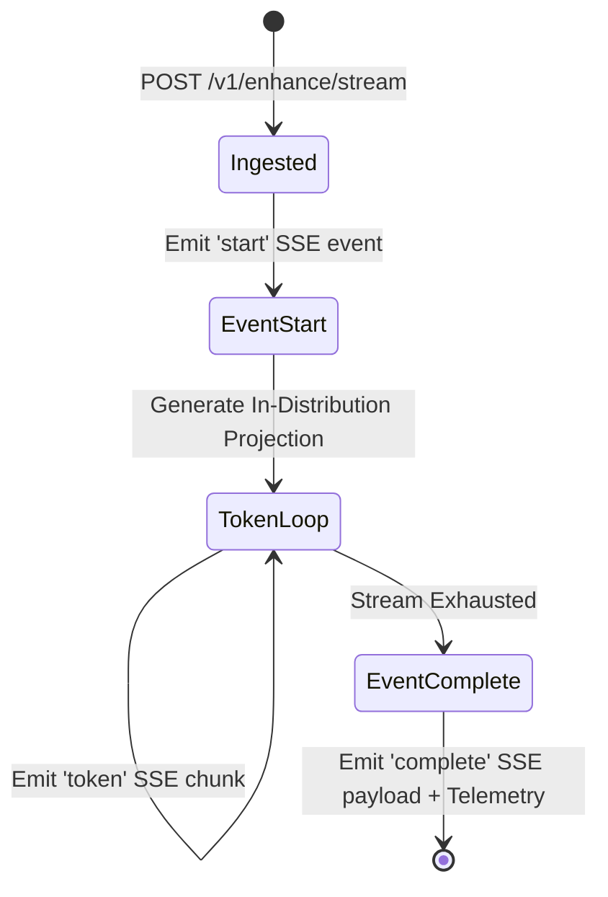

# PromptManifold Architecture Blueprint

## 1. System Overview

PromptManifold is an inference-time prompt distribution alignment engine designed to eliminate train-inference distribution mismatch in text-to-image and multimodal foundation models.

Generative models (including Flux, SDXL, Stable Diffusion 3.5, Midjourney, and DALL-E 3) are optimized on dense synthetic captions containing explicit spatial framing, lighting schemas, focal parameters, and stylistic qualifiers (~80 to 150 words). In contrast, production end-users provide sparse, conversational prompts (~3 to 8 words). Feeding sparse prompts directly into the model cross-attention layers causes out-of-distribution sampling, resulting in mode collapse, generic outputs, and hallucinated artifacts.

PromptManifold functions as a deterministic, sub-millisecond translation layer between user clients and foundation model runtimes. It decomposes sparse user queries, completes missing syntactic dimensions on the target manifold, applies model-specific token budgets, synthesizes dual negative constraints, and enforces strict semantic fidelity guards.

## 2. Core Subsystems

### 2.1 Syntactic Intent Decomposer (`prompt_manifold.core.intent`)
The intent decomposer inspects input strings to isolate core entities from stylistic modifiers. It extracts preserved tokens, parses explicit user exclusions ("no blur", "avoid neon") directly into the negative vector, and derives target medium classifications (`PHOTOGRAPHY`, `CINEMATIC`, `DIGITAL_ART`, `THREE_D_RENDER`, `ANIME_MANGA`, `OIL_PAINTING`, `VECTOR_FLAT`).

### 2.2 Manifold Projection Engine (`prompt_manifold.core.engine`)
The projection engine completes missing spatial and optical coordinates. If an input prompt lacks lighting or camera specifications, the engine synthesizes physically coherent attributes based on the identified subject and medium (for example, applying directional window sunlight and an 85mm prime lens to a teddy bear reading a book).

### 2.3 Target Distribution Adapters (`prompt_manifold.adapters`)
Each foundation model relies on distinct text encoder tokenization rules:
- **Flux Adapter**: Targets T5-XXL and CLIP-L encoders. Generates flowing English prose without comma-delimited quality tags, as tag spam degrades Flux latent rendering.
- **SDXL Adapter**: Formats tokens for dual CLIP-L / OpenCLIP-G encoders. Injects attention weights (`(subject:1.2)`) and separates explicit quality parameters.
- **Stable Diffusion 3.5 Adapter**: Formats multi-encoder prompts with stylistic anchoring.
- **Midjourney Adapter**: Injects CLI parameters including version flags (`--v 6.1`), aspect ratios (`--ar 16:9`), and styling weights (`--style raw`, `--stylize`).
- **DALL-E 3 Adapter**: Formats narrative paragraph descriptions with world-building context.

### 2.4 Semantic Drift Guard (`prompt_manifold.metrics.drift`)
To prevent the projection engine from hallucinating unrelated subjects, the drift guard measures token recall and entity retention between the raw query and the final projection:

$$\Delta_{\text{drift}} = (1.0 - \text{Recall}(T_{\text{raw}}, T_{\text{enhanced}})) \times 0.85$$

If $\Delta_{\text{drift}} > 0.15$, the projection is flagged for intent drift.

## 3. High-Throughput Streaming Pipeline

For interactive applications, PromptManifold exposes an asynchronous streaming pipeline (`PromptStreamer`). The service supports Server-Sent Events (SSE) emitting token deltas with sub-millisecond per-chunk latency, terminating with a structured `complete` payload containing full telemetry.

## 4. Failure Modes and Mitigations

| Failure Mode | Root Cause | Architectural Mitigation |
|---|---|---|
| **Semantic Drift / Hijacking** | Over-enrichment overwrites user core entity. | `SemanticDriftGuard` enforces entity retention before returning result. |
| **Negative Vector Contradiction** | Negative prompt contains subject tokens. | Automatic token deduplication and exclusion checking against subject slots. |
| **Encoder Token Overflow** | Prompt exceeds text encoder limit (e.g., 77 tokens in SDXL). | Target adapters enforce model-specific token budgets and priority truncation. |
| **Quality Tag Degradation** | Foundation model T5 encoder confused by tag salad. | Target-specific syntax modes (e.g. Flux adapter prohibits quality tag spam). |
| **Service Latency Spike** | Heavy NLP dependencies during inference. | Deterministic rule-based and regex-accelerated slot compilation executes in &lt;1.5ms. |
